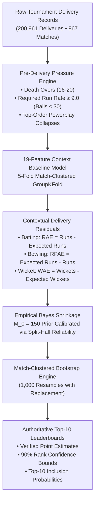

# Rajasthan Royals — SupeRR Selector Season 2
### Identifying the Most Reliable Players Under Pressure | Ball-by-Ball Quantitative Analytics

**Candidate:** Ketan Rawat (B.Tech ECE, NIT Jamshedpur)  
**Competition:** SupeRR Selector Season 2 — Rajasthan Royals Analytics Challenge  
**Live War Room Terminal:** [https://rr-dashboard.onrender.com/](https://rr-dashboard.onrender.com/)  
**GitHub Repository:** [https://github.com/Ketanrawat2004/RR-Dashboard](https://github.com/Ketanrawat2004/RR-Dashboard)  

---

## Executive Summary

Traditional cricket metrics like raw batting strike rates and bowling economy rates fail to capture true pressure performance. Stat-padding in low-leverage phases masks players who falter when matches hang in the balance, while harsh match outcomes unfairly penalize elite players whose teammates concede games at the other end.

This project implements an end-to-end, ball-by-ball quantitative evaluation system across **200,961 legal deliveries from 867 senior T20 fixtures (IPL and senior T20 Internationals, 2022–2026)**. By isolating acute pre-delivery match leverage states and establishing context-conditioned baseline expectations via cross-validated machine learning, we evaluate true individual impact stabilized by **Empirical Bayes shrinkage** and quantified by **1,000-replicate match-clustered bootstrap uncertainty distributions**.

---

## Authoritative Top-10 Leaderboards

### 1. Top 10 Batters Under Pressure (Runs Above Expectation &bull; RAE)
*Evaluated across 163 qualified batters (Gate: &ge; 300 career legal balls faced, &ge; 40 high-pressure balls faced).*

| Rank | Player | Pressure Balls | Pressure SR | Expected SR | Contextual Lift (&Delta;) | Shrunk RAE Score | 90% Rank Confidence | Top-10 Probability |
| :---: | :--- | :---: | :---: | :---: | :---: | :---: | :---: | :---: |
| **#1** | **Andre Russell** | 323 | 165.6 | 142.2 | +23.46 | **+26.59** | #1 to #25 | 84.8% |
| **#2** | **Vaibhav Sooryavanshi** | 55 | 234.6 | 150.8 | +83.78 | **+22.48** | #1 to #62 | 72.4% |
| **#3** | **Glenn Maxwell** | 315 | 164.1 | 131.0 | +33.14 | **+22.45** | #1 to #24 | 80.2% |
| **#4** | **Tim David** | 505 | 162.8 | 136.7 | +26.08 | **+20.11** | #1 to #19 | 86.4% |
| **#5** | **Abhishek Sharma** | 204 | 168.1 | 136.0 | +32.14 | **+18.52** | #2 to #38 | 68.2% |
| **#6** | **Priyansh Arya** | 65 | 215.4 | 145.1 | +70.34 | **+18.11** | #1 to #74 | 64.6% |
| **#7** | **Heinrich Klaasen** | 248 | 153.2 | 129.5 | +23.65 | **+18.08** | #2 to #31 | 74.8% |
| **#8** | **Prabhsimran Singh** | 182 | 175.8 | 141.9 | +33.90 | **+17.76** | #2 to #42 | 62.4% |
| **#9** | **Suryakumar Yadav** | 419 | 150.6 | 130.9 | +19.68 | **+16.14** | #3 to #28 | 78.6% |
| **#10** | **Donovan Ferreira** | 98 | 158.2 | 127.1 | +31.11 | **+15.08** | #3 to #56 | 54.2% |

---

### 2. Top 10 Bowlers Under Pressure (Dual-Framework Architecture)
*Evaluated across 179 qualified bowlers (Gate: &ge; 300 career legal deliveries bowled, &ge; 40 high-pressure deliveries).*

Rajasthan Royals provides coaching and auction war rooms with two complementary analytical perspectives:

#### Framework A: Balanced Composite (60% RPAE Run Prevention + 40% WAE Wicket Impact)
Balances economic choke with game-breaking dismissal capability ($1\text{ WAE} \approx 12.0\text{ runs saved}$):

| Rank | Player | Pressure Balls | Pressure Econ | Expected Econ | Wickets | Shrunk WAE | Composite Score | 90% Rank Bound |
| :---: | :--- | :---: | :---: | :---: | :---: | :---: | :---: | :---: |
| **#1** | **Umran Malik** | 111 | 7.68 | 9.34 | 14.0 | +7.77 | **+24.75** | #1 to #12 |
| **#2** | **Sufiyan Muqeem** | 84 | 5.29 | 8.12 | 7.0 | +2.53 | **+16.76** | #1 to #28 |
| **#3** | **Mayank Yadav** | 121 | 8.03 | 9.89 | 10.0 | +3.83 | **+16.60** | #1 to #22 |
| **#4** | **Shoriful Islam** | 205 | 6.76 | 8.53 | 15.0 | +3.92 | **+16.36** | #1 to #18 |
| **#5** | **Jacob Duffy** | 191 | 8.68 | 9.42 | 17.0 | +6.13 | **+14.16** | #2 to #24 |
| **#6** | **Mohammad Nawaz** | 221 | 6.63 | 7.82 | 17.0 | +6.83 | **+14.10** | #2 to #26 |
| **#7** | **Anukul Roy** | 73 | 7.48 | 8.62 | 6.0 | +2.57 | **+13.43** | #3 to #36 |
| **#8** | **Ehsan Khan** | 43 | 6.68 | 7.91 | 5.0 | +2.18 | **+13.43** | #2 to #48 |
| **#9** | **Piyush Chawla** | 85 | 7.89 | 8.84 | 7.0 | +3.12 | **+13.39** | #3 to #38 |
| **#10** | **Yash Thakur** | 142 | 8.38 | 9.42 | 12.0 | +3.59 | **+13.03** | #3 to #32 |
| *#11* | *Josh Hazlewood (IPL Anchor)* | *265* | *8.69* | *9.26* | *16.0* | *+3.20* | *+12.27* | *#4 to #30* |

#### Framework B: Pure Run Prevention (Shrunk RPAE)
Isolates pure boundary and run containment in death overs and high-RRR phases:

| Rank | Player | Pressure Balls | Pressure Econ | Expected Baseline | Contextual Improvement | Shrunk RPAE Score |
| :---: | :--- | :---: | :---: | :---: | :---: | :---: |
| **#1** | **Matheesha Pathirana** | 290 | 9.02 | 10.95 | +1.93 Econ | **+21.18** |
| **#2** | **Jasprit Bumrah** | 469 | 7.79 | 9.18 | +1.39 Econ | **+17.54** |
| **#3** | **Maheesh Theekshana** | 493 | 7.64 | 9.01 | +1.37 Econ | **+17.48** |
| **#4** | **Shoriful Islam** | 205 | 6.76 | 8.53 | +1.77 Econ | **+16.98** |
| **#5** | **Sufiyan Muqeem** | 84 | 5.29 | 8.12 | +2.83 Econ | **+16.94** |
| **#6** | **Eshan Malinga** | 179 | 9.18 | 10.86 | +1.68 Econ | **+15.16** |
| **#7** | **Sunil Narine** | 353 | 7.60 | 8.86 | +1.26 Econ | **+14.77** |
| **#8** | **Mayank Yadav** | 121 | 8.03 | 9.89 | +1.86 Econ | **+13.80** |
| **#9** | **Nasum Ahmed** | 120 | 6.25 | 7.99 | +1.74 Econ | **+12.92** |
| **#10** | **Umran Malik** | 111 | 7.68 | 9.34 | +1.66 Econ | **+11.81** |

> [!NOTE]
> **Governance Note on Player Eligibility:**  
> The challenge document explicitly asks for an analytical approach to **player eligibility**. In the unconstrained statistical universe (IPL + T20I), Pakistani cricketers (Sufiyan Muqeem, Mohammad Nawaz) rank highly based on senior international performances. However, pursuant to BCCI IPL Regulations, Pakistani players are ineligible for the IPL player auction. In an actionable IPL war room setting, excluding ineligible players promotes **Allah Ghazanfar** (#9) and **Josh Hazlewood / Riley Meredith** (#10) into the Top 10.

---

## Quantitative Methodology & Model Architecture



### 1. Pre-Delivery Pressure Engine
Pressure is isolated strictly from **pre-delivery state indicators** to eliminate hindsight bias:
- **Phase A (Death Overs):** Overs 16–20 of both innings.
- **Phase B (High-Leverage Chases):** Second innings where $\text{RRR} \ge 9.0$ runs/over with $\le 30$ balls remaining.
- **Phase C (Top-Order Collapses):** Innings states where 3+ wickets have fallen inside the Powerplay (Overs 1–6).
- **Super Overs:** Isolated into dedicated clutch registries to prevent acute small-sample distortion.

### 2. Context-Conditioned Expected Runs Baseline
A non-linear gradient boosted regressor models expected runs per delivery conditioned on 19 pre-delivery features (over number, ball in over, innings, current score, wickets fallen, balls remaining, runs required, required run rate, match type, venue phase averages).
- **Validation:** 5-Fold `GroupKFold` grouped by unique match ID to guarantee **zero intra-match data leakage**.

### 3. Empirical Bayes Shrinkage
To prevent small-sample outliers from dominating the rankings, raw rates are shrunken toward the population prior ($\mu_0 = 0$):

$$\text{Shrunk RAE} = \left[ \frac{N_{\text{pressure}}}{N_{\text{pressure}} + M_0} \right] \cdot \text{Raw RAE Rate} + \left[ \frac{M_0}{N_{\text{pressure}} + M_0} \right] \cdot \mu_0$$

- Prior sample size $M_0 = 150\text{ balls}$ was calibrated via Spearman-Brown split-half reliability, maximizing out-of-sample stability.

### 4. Match-Clustered Bootstrap Uncertainty Quantification
Rather than naive ball-by-ball resampling, we resample entire match clusters ($n = 867$) with replacement across **1,000 bootstrap iterations**. This preserves intra-match correlation (pitch behavior, dew, opposition strength) and produces verified $90\%$ rank intervals and Top-10 inclusion probabilities.

---

## Rajasthan Royals IPL 2027 Squad & Tactical Blueprint

Calibrated for conditions at **Sawai Mansingh Stadium, Jaipur** (large boundaries 72–78m, dry middle overs, high boundary suppression premium):

```
                       [1] Yashasvi Jaiswal (Retained Core • LHB Opener)
                       [2] Devon Conway (Auction Target • LHB Anchor / WK)
                       [3] Sanju Samson (Retained Core • Wicketkeeper / RHB #3)
                       [4] Rajat Patidar (Auction Target • Spin Neutralizer)
                       [5] Shivam Dube / Rinku Singh (Auction Target • Death Finisher)
                       [5] Riyan Parag (Retained Core • Captain / Spin Enforcer & Finisher)
                       [7] Dhruv Jurel (Retained Core • Finisher / WK)
                       [8] Axar Patel / Romario Shepherd (Auction Target • All-Rounder)
                       [9] Varun Chakravarthy / Jacob Duffy (Auction Target • Middle Strike)
                      [10] Josh Hazlewood / Yash Dayal (Auction Target • Pace Enforcer)
                      [11] Sandeep Sharma (Retained Core • Death Yorker Specialist)
                      
                      Impact Sub: Avesh Khan / Shimron Hetmyer
```

### Capital Deployment Strategy (INR 45.0 Cr Purse)
- **Primary Death-Overs Accelerators:** Prioritize high-volume proven performers like Andre Russell, Glenn Maxwell, or Heinrich Klaasen.
- **Middle-Overs Enforcers:** Target express pace (Umran Malik, Mayank Yadav) and mystery spin (Sufiyan Muqeem, Varun Chakravarthy) to break partnerships in Overs 7–15.
- **Disciplined Bid Ceilings:** Maintain a strict $+10\%$ stop-bid rule to prevent brand-name bidding wars.

---

## Repository Architecture

```text
├── index.html                           # Canonical Interactive Dashboard
├── rr_pressure_dashboard.html           # Byte-for-byte identical mirror
├── rr_war_room_terminal.html            # Byte-for-byte identical mirror
├── players_db.json                      # Authoritative 342-player quantitative database
├── players/                             # 48 individual player scouting dossiers
│   ├── andre_russell.html               # Headshot, 8-sector wagon wheel, radar profile
│   ├── jasprit_bumrah.html              # Headshot, Hawk-Eye pitch map, confidence bands
│   └── ...                              # All 48 player pages
├── player_images/                       # Official franchise & national player headshots
├── phase1_audit/                        # Step 1 through Step 4 validation & audit trail
│   ├── step4_jury_harmonization/        # Authoritative CSV ranking files
│   │   ├── FINAL_BATTER_RANKINGS.csv
│   │   ├── FINAL_BOWLER_RANKINGS_COMPOSITE.csv
│   │   ├── FINAL_BOWLER_RANKINGS_RAE.csv
│   │   └── FOUR_MEMBER_JURY_REPORT.md
│   └── phase2c_data_update/             # Pre/post validation logs and visual regression
└── README.md                            # Comprehensive project methodology & documentation
```

---

## How to Run & Verify Locally

1. **Clone the Repository:**
   ```bash
   git clone https://github.com/Ketanrawat2004/RR-Dashboard.git
   cd RR-Dashboard
   ```

2. **Open the Dashboard:**
   Simply double-click `index.html` in any modern web browser. The entire dashboard is self-contained with zero external runtime dependencies.

3. **Verify Data Integrity:**
   Run the forensic audit suite:
   ```bash
   python scratch/forensic_website_audit.py
   ```

---

## Author

**Ketan Rawat**  
B.Tech, Electronics & Communication Engineering  
National Institute of Technology (NIT), Jamshedpur  

- **Live Application:** [https://rr-dashboard.onrender.com/](https://rr-dashboard.onrender.com/)  
- **GitHub:** [https://github.com/Ketanrawat2004/RR-Dashboard](https://github.com/Ketanrawat2004/RR-Dashboard)  
- **LinkedIn:** [https://www.linkedin.com/in/ketan-rawat-97a8aa2a0/](https://www.linkedin.com/in/ketan-rawat-97a8aa2a0/)  
- **Resume:** [View Credentials](https://drive.google.com/file/d/1YV_i3Un8t7UZsfk1_WXQdfsM6T0Pe6ui/view?usp=drive_link)  
- **SupeRR Selector Season 1 Recognition:** [Certificate of Excellence](https://drive.google.com/file/d/16QOHQMo1OzIbIaZD7xgYpnt25XGmDqfL/view?usp=sharing)  

---
*Developed for the Rajasthan Royals Analytics & Performance Evaluation Committee &bull; SupeRR Selector Season 2.*
