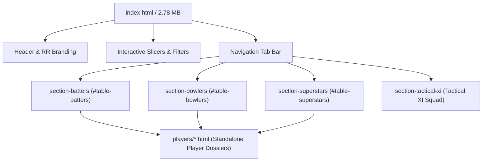

# EXISTING WEBSITE DEPENDENCY & ARCHITECTURE MAP
**Project:** Rajasthan Royals SupeRR Selector Season 2  
**Document:** Technical Dependency & Component Interaction Map  
**Location:** `phase1_audit/phase2a_blueprint/EXISTING_WEBSITE_DEPENDENCY_MAP.md`  
**Compliance Standard:** Strictly Read-Only Audit & Verification  
**Phase:** Phase 2A — Implementation Blueprint  

---

## 1. CORE WEB DELIVERABLES & ENTRY POINTS

The Rajasthan Royals analytics platform is delivered as a static, client-side web application. It features three root HTML dashboard files that serve as entry points:

#### Table 1.1: Production HTML Files Verification
| File Name | Location | File Size (Bytes) | SHA-256 Hash | Relationship |
| :--- | :--- | :---: | :---: | :--- |
| **`index.html`** | `C:\RR NEW\index.html` | 2,791,623 | `017210f1b681682c548b9554bb3d972929bc6eeb6dc00d4c1123ccdb2e16df25` | Primary Root Entry Point |
| **`rr_pressure_dashboard.html`** | `C:\RR NEW\rr_pressure_dashboard.html` | 2,791,623 | `017210f1b681682c548b9554bb3d972929bc6eeb6dc00d4c1123ccdb2e16df25` | Byte-for-byte Mirror |
| **`rr_war_room_terminal.html`** | `C:\RR NEW\rr_war_room_terminal.html` | 2,791,623 | `017210f1b681682c548b9554bb3d972929bc6eeb6dc00d4c1123ccdb2e16df25` | Byte-for-byte Mirror |

> **Critical Architecture Rule:** The three files above are **100% byte-for-byte identical**. Any Phase 2 implementation must strictly update and synchronize all three files simultaneously to maintain parity across bookmarks, hosting routes, and offline terminal deployments.

---

## 2. DOM STRUCTURE & SECTION ARCHITECTURE

`index.html` is structured as a single-page dashboard with tab-switched views.



### 2.1 The Four Data Sections
1. **`#section-batters` (`class="table-responsive data-section"`):**
   - Active by default (`display: block`).
   - Hosts `#table-batters` containing the Top 10 Batting rankings.
2. **`#section-bowlers` (`class="table-responsive data-section" style="display:none;"`):**
   - Hidden by default.
   - Hosts `#table-bowlers` containing the Top 10 Bowling rankings.
3. **`#section-superstars` (`class="table-responsive data-section" style="display:none;"`):**
   - Hidden by default.
   - Hosts `#table-superstars` containing the Leverage Variance Audit for marquee superstar players (Kohli, Rohit, Klaasen, Bumrah, Siraj).
4. **`#section-tactical-xi` (`class="data-section" style="display:none;margin-top:16px;"`):**
   - Hidden by default.
   - Displays the recommended Rajasthan Royals IPL 2027 starting XI squad, auction bid ceilings, and tactical role allocations.

---

## 3. INTERACTIVE CONTROLS & JAVASCRIPT SLICER ENGINE

The dashboard contains an inline JavaScript engine (3,797 characters) located at the bottom of `index.html`. It operates entirely on DOM elements without any external framework dependencies.

### 3.1 Control Elements
- **Text Search Input (`#filterInput`):**
  - Text input allowing real-time query filtering across player names, roles, and franchise affiliations.
  - Event: `onkeyup="applySlicers()"`.
- **Role Slicer (`#roleSlicer`):**
  - Dropdown filter with options:
    - `ALL`: Display all roles.
    - `TOP_ORDER`: Filters players with roles containing `TOP`, `OPEN`, `ANCHOR`.
    - `MIDDLE_ORDER`: Filters players with roles containing `MIDDLE`, `SPIN`.
    - `FINISHER`: Filters players with roles containing `FINISH`, `DEATH`, `STRIKE`.
    - `PACE`: Filters bowlers with roles containing `PACE`, `SEAM`, `SWING`.
    - `SPIN`: Filters bowlers with roles containing `SPIN`, `ROUNDER`, `WRIST`, `MYSTERY`.
  - Event: `onchange="applySlicers()"`.
- **Sort Slicer (`#sortSlicer`):**
  - Dropdown sorter with options:
    - `RANK`: Sorts by `data-rank` (ascending numerical order).
    - `INDEX`: Sorts by `data-index` (descending overall score).
    - `DIFF`: Sorts by `data-diff` (descending clutch lift $\Delta$).
    - `WIN`: Sorts by `data-win` (descending pressure win rate / performance rate).
  - Event: `onchange="applySlicers()"`.
- **Reset Button (`onclick="resetSlicers()"`):**
  - Resets `#filterInput` to `""`, `#roleSlicer` to `"ALL"`, `#sortSlicer` to `"RANK"`, and executes `applySlicers()`.

### 3.2 JavaScript Functions in `index.html`
- **`showSection(sectionId, btn)`:**
  - Hides all `.data-section` containers.
  - Deactivates all `.nav-tab-btn` buttons.
  - Activates the selected tab and sets `#section-` + `sectionId` to `display: block`.
  - Triggers `applySlicers()` to apply active filters to the newly visible table.
- **`applySlicers()`:**
  - Reads values from `#filterInput`, `#roleSlicer`, and `#sortSlicer`.
  - Identifies the currently active table tbody.
  - Iterates over all `<tr>` elements:
    - Evaluates query match against `row.textContent.toLowerCase()`.
    - Evaluates role filter match against `row.getAttribute('data-role').toUpperCase()`.
    - Sets `row.style.display = ''` if matched, or `'none'` if filtered out.
  - Sorts matching rows in DOM memory based on `data-rank`, `data-index`, `data-diff`, or `data-win`.
  - Re-appends sorted rows to `tbody`.

---

## 4. TABLE ROW DATA CONTRACT & ATTRIBUTES

Every row in `#table-batters` and `#table-bowlers` adheres to a strict HTML contract required by the JavaScript slicer engine and navigation system:

```html
<tr onclick="window.location.href='players/shivam_dube.html'" 
    data-role="Specialist Boundary Striker vs Spin" 
    data-diff="12.4" 
    data-win="66.7" 
    data-index="66.81" 
    data-rank="1">
    <td style="font-weight:700;color:#09090B;">1</td>
    <td>
        <div class="player-flex">
            <a href="players/shivam_dube.html" onclick="event.stopPropagation();">
                <div class="thumb-img"></div>
            </a>
            <div class="name-box">
                <a href="players/shivam_dube.html" onclick="event.stopPropagation();">Shivam Dube</a>
                <div class="team-sub">Specialist Boundary Striker vs Spin</div>
            </div>
        </div>
    </td>
    <td>Chennai Super Kings, India, Mumbai</td>
    <td style="text-align:center;font-weight:600;">18</td>
    <td style="text-align:right;font-weight:700;color:#09090B;">66.7%</td>
    <td style="text-align:right;color:var(--text-muted);">54.3%</td>
    <td style="text-align:center;"><span class="diff-tag diff-pos">+12.4%</span></td>
    <td style="text-align:center;font-weight:600;">1</td>
    <td style="text-align:right;font-weight:700;">100.0%</td>
    <td style="text-align:right;font-weight:800;color:#09090B;">66.81</td>
    <td style="text-align:center;">
        <a href="players/shivam_dube.html" class="action-link" onclick="event.stopPropagation();">View Wagon Wheel &rarr;</a>
    </td>
</tr>
```

#### Table 4.1: Required TR Attributes and Display Columns
| Element / Attribute | Purpose | Existing Value Type | Phase 2 Harmonized Mapping |
| :--- | :--- | :--- | :--- |
| `onclick` | Whole-row navigation | `window.location.href='players/<key>.html'` | Must point to valid `players/<key>.html` |
| `data-role` | Role slicer filtering | String (e.g. `"Specialist Finisher"`) | Preserved tactical role string |
| `data-diff` | Diff sorting | Float (e.g. `12.4`) | Mapped to `clutch_rae_lift` or `clutch_rpae_lift` |
| `data-win` | Win rate sorting | Float (e.g. `66.7`) | Mapped to `pressure_sr` or `pressure_econ` |
| `data-index` | Score sorting | Float (e.g. `66.81`) | Mapped to `shrunk_rae_score` or `composite_score` |
| `data-rank` | Rank sorting | Integer (e.g. `1`) | Mapped to official Step 4 Rank (#1 to #10) |
| Column 1 | Rank display | `#` | `rank` |
| Column 2 | Player & Role | Thumbnail, Name link, Role subtitle | Photo, Name link, Role subtitle, Badge |
| Column 3 | Franchise / State | Text string | Franchises / State teams |
| Column 4 | Leverage Volume | Integer count | Pressure balls faced / bowled ($N$) |
| Column 5 | Pressure Perf | Percentage | Pressure Strike Rate / Economy |
| Column 6 | Baseline Perf | Percentage | Expected Baseline Rate |
| Column 7 | Perf Diff ($\Delta$) | Tagged badge (`+Δ%`) | RAE / RPAE Rate residual |
| Column 8 | Career Volume | Integer count | Career legal balls faced / bowled |
| Column 9 | 90% Rank Bound | Range string | Bootstrap Rank Bound (e.g. `#1 to #25`) |
| Column 10| Shrunk Score | Float value | Empirical Bayes Shrunk Score |
| Column 11| Action Link | `<a>` link | Link to `players/<key>.html` |

---

## 5. STANDALONE PLAYER DOSSIER DEPENDENCIES

The directory `players/` currently houses **25 standalone HTML files**. Each dossier is a self-contained, high-detail analytical profile.

### 5.1 Player Dossier Structure
- **Embedded Visualizations:**
  - Base64-encoded player headshot.
  - Wagon wheel or pitch map graphics.
  - Tactical match-up radar charts.
- **Navigation Controls:**
  - Return link to dashboard: `<a href="../index.html">← Back to Master Leaderboard</a>`.
  - Next / Previous player carousel navigation (e.g. `rinku_singh.html` $\leftrightarrow$ `shivam_dube.html`).
- **External Citations:**
  - Links to LinkedIn profile, GitHub repository, and Google Drive submission decks.

### 5.2 Dossier Coupling Risk
In `index.html`, every table row contains three separate links to `players/<key>.html`:
1. Row `onclick` event: `onclick="window.location.href='players/<key>.html'"`
2. Thumbnail image wrapper: `<a href="players/<key>.html">`
3. Action button: `<a href="players/<key>.html" class="action-link">`

**If a player is listed in `index.html` without a corresponding `players/<key>.html` file on disk, clicking anywhere on that player's row triggers an immediate HTTP 404 broken file error.**

---

## 6. EXTERNAL SCRIPTS & ARTIFACT DEPENDENCIES

In addition to the web dashboard, three Python scripts and two compiled deliverables form the complete Rajasthan Royals analytics suite:

#### Table 6.1: Presentation Scripts & Artifacts
| Script / Artifact | Dependencies | Impact of Phase 2 Website Changes |
| :--- | :--- | :--- |
| **`build_clean_submission_pptx.py`** | Reads `players_db.json` directly (`with open("players_db.json")`) | Depends on `players_db.json` schema. Will crash if keys are removed or altered. |
| **`build_submission_pdf.py`** | Hardcodes key metric names (CPPI, Win Rate) | Must be updated to reflect Pure RAE and Balanced Composite metrics. |
| **`build_submission_pptx.py`** | Hardcodes executive summary and player tables | Must be updated to reflect harmonized player rankings. |
| **`RR_SupeRR_Selector_Season2_Report_Ketan_Rawat.pdf`** | Compiled ReportLab deliverable | Must be re-compiled after script updates. |
| **`RR_SupeRR_Selector_Season2_Ketan_Rawat.pptx`** | Compiled python-pptx deliverable | Must be re-compiled after script updates. |

---

## 7. CRITICAL PRESERVATION CONSTRAINTS FOR PHASE 2

1. **Retain CSS Variable Names:** Do not alter `:root` color tokens (`--rr-pink: #EB1A8D`, `--rr-navy: #001D48`, `--border: #E2E8F0`, etc.).
2. **Retain Slicer Engine Attributes:** All newly generated `<tr>` rows must include `data-role`, `data-diff`, `data-win`, `data-index`, and `data-rank` attributes to prevent `applySlicers()` from throwing JavaScript null reference exceptions.
3. **Preserve Section IDs:** The IDs `#section-batters`, `#section-bowlers`, `#section-superstars`, and `#section-tactical-xi` must remain unchanged to ensure `showSection()` continues functioning.
4. **Preserve Synchronized Triplet:** Any build process must output identical contents to `index.html`, `rr_pressure_dashboard.html`, and `rr_war_room_terminal.html`.

