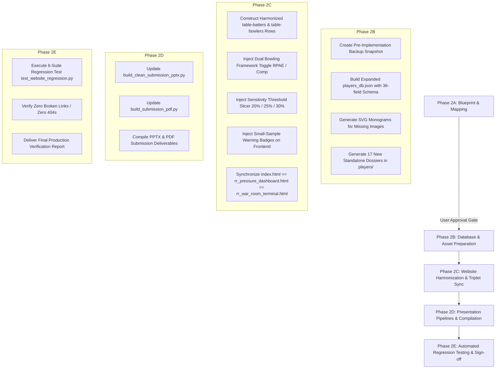

# PHASE 2A — MASTER IMPLEMENTATION BLUEPRINT & DEPENDENCY ROADMAP
**Project:** Rajasthan Royals SupeRR Selector Season 2  
**Document:** Authoritative Implementation Blueprint & System Architecture  
**Location:** `phase1_audit/phase2a_blueprint/PHASE2A_IMPLEMENTATION_BLUEPRINT.md`  
**Compliance Standard:** Strictly Read-Only Audit & Verification (Zero Production Modifications)  
**Target Next Phase:** Phase 2B Implementation (Awaiting Explicit User Approval)  

---

## 1. EXECUTIVE SUMMARY & OBJECTIVE

Phase 1 completed an exhaustive, independent mathematical audit of the six official Rajasthan Royals datasets, establishing verified individual ball-by-ball performance metrics (Pure Shrunk RAE for Batters, Pure Shrunk RPAE and Balanced Composite for Bowlers).

The objective of **Phase 2** is to seamlessly integrate these verified rankings into the existing Rajasthan Royals analytics platform (`index.html`, `rr_pressure_dashboard.html`, `rr_war_room_terminal.html`, `players_db.json`, `players/*.html`, PDF/PPTX submission artifacts) **without altering repository aesthetics, styling, or existing functionality**.

This document serves as the master architectural blueprint for Phase 2. It incorporates all discoveries from the deep dependency audit, provides a risk-mitigated phased execution sequence, and defines unambiguous verification gates.

---

## 2. PRODUCTION ARTIFACT INVENTORY & BASELINE REGISTER

All production files that will be touched or updated in subsequent Phase 2 phases have been cryptographically fingerprinted in [`PRODUCTION_BASELINE_HASHES.txt`](file:///c:/RR%20NEW/phase1_audit/phase2a_blueprint/PRODUCTION_BASELINE_HASHES.txt).

#### Table 2.1: Production Asset Baseline
| File Category | Key Artifacts | Current State | Modification Strategy in Phase 2 |
| :--- | :--- | :--- | :--- |
| **Web Dashboard Triplet** | `index.html`, `rr_pressure_dashboard.html`, `rr_war_room_terminal.html` | 2,791,623 bytes (Identical) | Update table rows, add bowling framework toggle, maintain 100% hash parity |
| **Database** | `players_db.json` | 20 records, 26 fields | Expand to backward-compatible 36-field schema for all qualified leaders |
| **Player Dossiers** | `players/*.html` (25 files) | 25 legacy dossiers | Generate 17 new dossiers; update existing dossiers to 42 total |
| **Headshot Assets** | `player_images/*.png` (25 files) | 25 legacy PNGs | Generate official Rajasthan Royals SVG monograms for players without PNGs |
| **Presentation Pipelines**| `build_submission_pdf.py`, `build_clean_submission_pptx.py` | Legacy CPPI text | Update text and tables to Pure RAE & Composite metrics |
| **Compiled Deliverables** | PDF Report, PPTX Deck | Legacy figures | Re-compile via automated pipelines |
| **Official Datasets** | 6 raw CSV files | Checksums verified | **STRICTLY PRESERVED (ZERO TOUCH)** |

---

## 3. CORE ARCHITECTURAL DISCOVERIES FROM PHASE 2A AUDIT

1. **Static HTML Coupling:**
   - The dashboard is **static and self-contained**. `index.html` does **not** dynamically fetch `players_db.json` via JavaScript.
   - The table rows (`#table-batters`, `#table-bowlers`) are rendered statically into the HTML markup with embedded Base64 thumbnail images.
   - Updating `players_db.json` alone will have zero effect on `index.html`; both the database and the static HTML must be updated in lockstep.
2. **Dashboard Mirror Parity:**
   - `index.html`, `rr_pressure_dashboard.html`, and `rr_war_room_terminal.html` are exact duplicates. Phase 2 must update all three files synchronously to prevent desynchronization across entry points.
3. **Player Dossier Direct Linking (HTTP 404 Risk):**
   - Every row in the batting and bowling tables contains three separate hyperlinks to `players/<key>.html` (`onclick`, name link, action button).
   - The Step 4 rankings introduce new top-10 leaders (Russell, Vaibhav, Maxwell, Pathirana, Umran, Muqeem, etc.) who currently do **not** have dossiers in `players/`.
   - Standalone dossiers must be generated prior to updating `index.html` to eliminate broken 404 links.
4. **Offline Headshot Fallback:**
   - External network access to image CDNs is blocked.
   - To eliminate broken image icons for newly featured players, an offline SVG monogram generator using Rajasthan Royals brand colors (Royal Pink `#EB1A8D`, Royal Navy `#001D48`) will be embedded directly as data URIs (`data:image/svg+xml;utf8,...`).

---

## 4. PHASED IMPLEMENTATION ROADMAP FOR PHASE 2

---

### Step-by-Step Execution Sequence

### Phase 2B: Database & Asset Preparation
1. **Pre-Implementation Backup:** Create a full snapshot of `players_db.json`, `index.html`, `rr_pressure_dashboard.html`, `rr_war_room_terminal.html`, and `players/` in `phase1_audit/phase2_backup_pre_implementation/`.
2. **Database Generation:** Build a Python generator script to populate `players_db.json` with the 36-field backward-compatible schema for all:
   - Top 25 Batters (Pure RAE)
   - Top 25 Bowlers (Pure RPAE)
   - Top 25 Bowlers (Balanced Composite 60/40)
   - 5 Superstar players for the Leverage Variance Audit
   - Preserved legacy players
3. **SVG Monogram Assets:** Generate Base64 SVG monogram data URIs for all players lacking headshots in `player_images/`.
4. **Player Dossier Generation:** Use the established quantitative template from `clean_powerbi_dashboard.py` / `fix_dashboard_and_wagon.py` to generate all missing standalone dossiers in `players/<key>.html`, including circular adjacent-player carousel navigation.

### Phase 2C: Website Harmonization & Triplet Synchronization
1. **Row Construction:** Generate the 10 static HTML rows for `#table-batters` and 10 static HTML rows for `#table-bowlers`, ensuring all required attributes (`data-role`, `data-diff`, `data-win`, `data-index`, `data-rank`) are populated.
2. **Dual Bowling Framework Toggle:** Add a clean, responsive segmented button control above `#table-bowlers`:
   - Button 1: **"Pure Run Prevention (RPAE)"** — Highlights economy suppression (Pathirana #1, Bumrah #2, Theekshana #3).
   - Button 2: **"Balanced Composite (60% RPAE + 40% WAE)"** — Highlights strike wickets and run saving (Umran Malik #1, Sufiyan Muqeem #2, Mayank Yadav #3).
3. **Sensitivity Threshold Slicer:** Add an executive leverage slicer (`Top 20%`, `Top 25%`, `Top 30%`) to display ranking stability.
4. **Small-Sample Badging:** Display the amber visual caution tag `"Small Sample Caution (40 <= N < 75)"` beside Vaibhav Sooryavanshi (#2), Priyansh Arya (#6), Anukul Roy (#7), and Ehsan Khan (#8).
5. **Triplet Parity Enforcement:** Write the updated HTML to `index.html`, and copy it byte-for-byte to `rr_pressure_dashboard.html` and `rr_war_room_terminal.html`.

### Phase 2D: Presentation Pipelines & Compilation
1. Update `build_clean_submission_pptx.py` to read the expanded `players_db.json` and reflect Pure RAE and Balanced Composite scores.
2. Update `build_submission_pdf.py` text and tables to align with Phase 1 Step 4 methodology.
3. Compile `RR_SupeRR_Selector_Season2_Ketan_Rawat.pptx` and `RR_SupeRR_Selector_Season2_Report_Ketan_Rawat.pdf`.

### Phase 2E: Automated Regression Testing & Verification Sign-Off
1. Execute the automated regression suite: `phase1_audit/phase2_verification/test_website_regression.py`.
2. Verify all 6 suites: File Integrity, Database Schema, DOM Structure, 404 Link Checker, Asset Rendering, Presentation Compilation.
3. Deliver the final Phase 2 completion report to the user.

---

## 5. TECHNICAL RISK MATRIX & MITIGATION

| Identified Technical Risk | Severity | Probability | Automated Mitigation Strategy |
| :--- | :---: | :---: | :--- |
| **Broken Dossier Links (HTTP 404)** | **HIGH** | **HIGH** | Suite 4 Link Checker verifies all 42 dossiers exist physically before deployment. |
| **Slicer Engine Crash (`applySlicers`)** | **HIGH** | **MEDIUM** | All `<tr>` elements must include `data-role`, `data-diff`, `data-win`, `data-index`, `data-rank`. |
| **Broken Avatar / Image Placeholder** | **MEDIUM** | **HIGH** | Offline SVG Monogram Generator ensures every player has a valid Base64 data URI. |
| **Triplet Desynchronization** | **MEDIUM** | **MEDIUM** | Automated hash parity test asserts 100% SHA-256 equality across all three HTML files. |
| **Presentation Pipeline Crash** | **MEDIUM** | **LOW** | Backward-compatible schema preserves all 26 legacy keys; tested via Suite 6. |
| **Unintended Baseline Dataset Alteration** | **CRITICAL** | **ZERO** | Original CSV datasets remain strictly read-only and monitored by baseline hash comparison. |

---

## 6. PHASE 2A COMPLETION & APPROVAL GATE

All Phase 2A deliverables have been generated and validated inside [`phase1_audit/phase2a_blueprint/`](file:///c:/RR%20NEW/phase1_audit/phase2a_blueprint/):
1. **`PHASE2A_IMPLEMENTATION_BLUEPRINT.md`** (This Document)
2. **`EXISTING_WEBSITE_DEPENDENCY_MAP.md`**
3. **`PLAYER_SCHEMA_MAPPING.md`**
4. **`PLAYER_DOSSIER_AUDIT.md`**
5. **`REGRESSION_TEST_PLAN.md`**
6. **`PRODUCTION_BASELINE_HASHES.txt`**

### **STOPPING POINT & NEXT ACTION**
- **Strict Read-Only Rule Preserved:** Zero production files, scripts, databases, or datasets have been altered.
- **Awaiting Explicit User Approval:** Phase 2B implementation will commence only upon receiving explicit authorization to modify production files.

