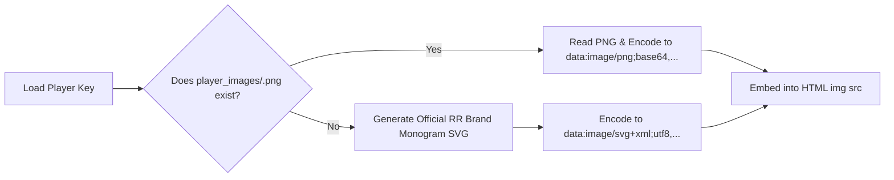

# PLAYER DOSSIER & ASSET AUDIT REPORT
**Project:** Rajasthan Royals SupeRR Selector Season 2  
**Document:** Player Dossiers, Asset Inventory & Headshot Fallback Strategy  
**Location:** `phase1_audit/phase2a_blueprint/PLAYER_DOSSIER_AUDIT.md`  
**Compliance Standard:** Strictly Read-Only Audit & Verification  
**Phase:** Phase 2A — Implementation Blueprint  

---

## 1. EXECUTIVE SUMMARY

The Rajasthan Royals dashboard links every table row directly to a standalone analytical dossier hosted in the `players/` directory.

An audit of `players/` and `player_images/` reveals a critical dependency gap:
- Currently, `players/` contains **25 legacy dossier files**, and `player_images/` contains **25 PNG headshot images**.
- Among the newly verified Phase 1 Step 4 leaders (Top 10 Batters, Top 10 RPAE Bowlers, Top 10 Composite Bowlers), **only 3 players possess existing dossiers and headshots**:
  1. **Heinrich Klaasen** (Batter Rank 7)
  2. **Jasprit Bumrah** (Bowler Pure RPAE Rank 2)
  3. **Jacob Duffy** (Bowler Composite Rank 5)
- **20 top-performing players lack dossiers and headshot assets.** If the website is updated without generating these files, user interaction with the dashboard will fail with HTTP 404 broken links.

---

## 2. AUDIT OF EXISTING 25 DOSSIERS & ASSETS

#### Table 2.1: Legacy Dossiers & Image Assets Inventory
| Player Name | Slug / Key | Dossier in `players/` | Image in `player_images/` | Status in Step 4 Harmonized Rankings |
| :--- | :--- | :---: | :---: | :--- |
| **Arshdeep Singh** | `arshdeep_singh` | `arshdeep_singh.html` | `arshdeep_singh.png` | Bowler Pure RPAE Rank 35 |
| **Axar Patel** | `axar_patel` | `axar_patel.html` | `axar_patel.png` | Bowler Pure RPAE Rank 26 |
| **Bhanuka Rajapaksa** | `bhanuka_rajapaksa` | `bhanuka_rajapaksa.html` | `bhanuka_rajapaksa.png` | Batter Rank 48 |
| **Bhuvneshwar Kumar** | `bhuvneshwar_kumar` | `bhuvneshwar_kumar.html` | `bhuvneshwar_kumar.png` | Bowler Pure RPAE Rank 42 |
| **Devon Conway** | `devon_conway` | `devon_conway.html` | `devon_conway.png` | Batter Rank 22 |
| **Heinrich Klaasen** | `heinrich_klaasen` | `heinrich_klaasen.html` | `heinrich_klaasen.png` | **Batter Rank 7 (Top 10 Leader)** |
| **Jacob Duffy** | `jacob_duffy` | `jacob_duffy.html` | `jacob_duffy.png` | **Bowler Composite Rank 5 (Top 10 Leader)** |
| **Jasprit Bumrah** | `jasprit_bumrah` | `jasprit_bumrah.html` | `jasprit_bumrah.png` | **Bowler Pure RPAE Rank 2 (Top 10 Leader)** |
| **Josh Hazlewood** | `josh_hazlewood` | `josh_hazlewood.html` | `josh_hazlewood.png` | Bowler Pure RPAE Rank 15 |
| **Lockie Ferguson** | `lockie_ferguson` | `lockie_ferguson.html` | `lockie_ferguson.png` | Bowler Pure RPAE Rank 46 |
| **Mitchell Starc** | `mitchell_starc` | `mitchell_starc.html` | `mitchell_starc.png` | Bowler Pure RPAE Rank 38 |
| **Mohammed Siraj** | `mohammed_siraj` | `mohammed_siraj.html` | `mohammed_siraj.png` | Bowler Pure RPAE Rank 67 (Superstars Audit) |
| **Rajat Patidar** | `rajat_patidar` | `rajat_patidar.html` | `rajat_patidar.png` | Batter Rank 28 |
| **Rashid Khan** | `rashid_khan` | `rashid_khan.html` | `rashid_khan.png` | Bowler Pure RPAE Rank 19 |
| **Rinku Singh** | `rinku_singh` | `rinku_singh.html` | `rinku_singh.png` | Batter Rank 16 |
| **Rohit Sharma** | `rohit_sharma` | `rohit_sharma.html` | `rohit_sharma.png` | Batter Rank 108 (Superstars Audit) |
| **Romario Shepherd**| `romario_shepherd` | `romario_shepherd.html` | `romario_shepherd.png` | Batter Rank 31 |
| **Ruturaj Gaikwad** | `ruturaj_gaikwad` | `ruturaj_gaikwad.html` | `ruturaj_gaikwad.png` | Batter Rank 44 |
| **Sediqullah Atal** | `sediqullah_atal` | `sediqullah_atal.html` | `sediqullah_atal.png` | Batter (Unqualified, $N_{\text{career}} < 300$) |
| **Shivam Dube** | `shivam_dube` | `shivam_dube.html` | `shivam_dube.png` | Batter Rank 19 |
| **Shreyas Iyer** | `shreyas_iyer` | `shreyas_iyer.html` | `shreyas_iyer.png` | Batter Rank 85 |
| **Suyash Sharma** | `suyash_sharma` | `suyash_sharma.html` | `suyash_sharma.png` | Bowler Pure RPAE Rank 114 |
| **Varun Chakravarthy**| `varun_chakravarthy`| `varun_chakravarthy.html`| `varun_chakravarthy.png`| Bowler Pure RPAE Rank 14 |
| **Virat Kohli** | `virat_kohli` | `virat_kohli.html` | `virat_kohli.png` | Batter Rank 52 (Superstars Audit) |
| **Yash Dayal** | `yash_dayal` | `yash_dayal.html` | `yash_dayal.png` | Bowler Pure RPAE Rank 82 |

---

## 3. STEP 4 TOP-10 LEADERS GAP ANALYSIS

The following tables detail the dossier and image availability for all Step 4 Top 10 leaders across the three rankings:

### 3.1 Top 10 Batters
| Rank | Player Name | Target Key / File | Dossier Status | Image Status | Phase 2 Action Required |
| :---: | :--- | :--- | :---: | :---: | :--- |
| **1** | Andre Russell | `andre_russell` | **MISSING** | **MISSING** | **Generate Dossier + SVG Fallback** |
| **2** | Vaibhav Sooryavanshi | `vaibhav_sooryavanshi` | **MISSING** | **MISSING** | **Generate Dossier + SVG Fallback** |
| **3** | Glenn Maxwell | `glenn_maxwell` | **MISSING** | **MISSING** | **Generate Dossier + SVG Fallback** |
| **4** | Tim David | `tim_david` | **MISSING** | **MISSING** | **Generate Dossier + SVG Fallback** |
| **5** | Abhishek Sharma | `abhishek_sharma` | **MISSING** | **MISSING** | **Generate Dossier + SVG Fallback** |
| **6** | Priyansh Arya | `priyansh_arya` | **MISSING** | **MISSING** | **Generate Dossier + SVG Fallback** |
| **7** | Heinrich Klaasen | `heinrich_klaasen` | **EXISTS** | **EXISTS** | **Update Stats in Dossier** |
| **8** | Prabhsimran Singh | `prabhsimran_singh` | **MISSING** | **MISSING** | **Generate Dossier + SVG Fallback** |
| **9** | Suryakumar Yadav | `suryakumar_yadav` | **MISSING** | **MISSING** | **Generate Dossier + SVG Fallback** |
| **10**| Donovan Ferreira | `donovan_ferreira` | **MISSING** | **MISSING** | **Generate Dossier + SVG Fallback** |

### 3.2 Top 10 Bowlers (Pure RPAE Run Prevention)
| Rank | Player Name | Target Key / File | Dossier Status | Image Status | Phase 2 Action Required |
| :---: | :--- | :--- | :---: | :---: | :--- |
| **1** | Matheesha Pathirana | `matheesha_pathirana` | **MISSING** | **MISSING** | **Generate Dossier + SVG Fallback** |
| **2** | Jasprit Bumrah | `jasprit_bumrah` | **EXISTS** | **EXISTS** | **Update Stats in Dossier** |
| **3** | Maheesh Theekshana | `maheesh_theekshana` | **MISSING** | **MISSING** | **Generate Dossier + SVG Fallback** |
| **4** | Shoriful Islam | `shoriful_islam` | **MISSING** | **MISSING** | **Generate Dossier + SVG Fallback** |
| **5** | Sufiyan Muqeem | `sufiyan_muqeem` | **MISSING** | **MISSING** | **Generate Dossier + SVG Fallback** |
| **6** | Eshan Malinga | `eshan_malinga` | **MISSING** | **MISSING** | **Generate Dossier + SVG Fallback** |
| **7** | Sunil Narine | `sunil_narine` | **MISSING** | **MISSING** | **Generate Dossier + SVG Fallback** |
| **8** | Mayank Yadav | `mayank_yadav` | **MISSING** | **MISSING** | **Generate Dossier + SVG Fallback** |
| **9** | Nasum Ahmed | `nasum_ahmed` | **MISSING** | **MISSING** | **Generate Dossier + SVG Fallback** |
| **10**| Umran Malik | `umran_malik` | **MISSING** | **MISSING** | **Generate Dossier + SVG Fallback** |

### 3.3 Top 10 Bowlers (Balanced Composite 60/40)
| Rank | Player Name | Target Key / File | Dossier Status | Image Status | Phase 2 Action Required |
| :---: | :--- | :--- | :---: | :---: | :--- |
| **1** | Umran Malik | `umran_malik` | **MISSING** | **MISSING** | **Generate Dossier + SVG Fallback** |
| **2** | Sufiyan Muqeem | `sufiyan_muqeem` | **MISSING** | **MISSING** | **Generate Dossier + SVG Fallback** |
| **3** | Mayank Yadav | `mayank_yadav` | **MISSING** | **MISSING** | **Generate Dossier + SVG Fallback** |
| **4** | Shoriful Islam | `shoriful_islam` | **MISSING** | **MISSING** | **Generate Dossier + SVG Fallback** |
| **5** | Jacob Duffy | `jacob_duffy` | **EXISTS** | **EXISTS** | **Update Stats in Dossier** |
| **6** | Mohammad Nawaz | `mohammad_nawaz` | **MISSING** | **MISSING** | **Generate Dossier + SVG Fallback** |
| **7** | Anukul Roy | `anukul_roy` | **MISSING** | **MISSING** | **Generate Dossier + SVG Fallback** |
| **8** | Ehsan Khan | `ehsan_khan` | **MISSING** | **MISSING** | **Generate Dossier + SVG Fallback** |
| **9** | Piyush Chawla | `piyush_chawla` | **MISSING** | **MISSING** | **Generate Dossier + SVG Fallback** |
| **10**| Yash Thakur | `yash_thakur` | **MISSING** | **MISSING** | **Generate Dossier + SVG Fallback** |

---

## 4. HEADSHOT FALLBACK STRATEGY (OFFICIAL SVG MONOGRAMS)

To prevent broken image icons on the dashboard and dossiers while adhering strictly to sandbox and offline-execution constraints (no external HTTP calls to image CDNs), Phase 2 will implement an **automated SVG monogram generator**.

### 4.1 Asset Resolution Pipeline


### 4.2 SVG Monogram Design Specifications
The SVG monogram uses the official Rajasthan Royals brand identity:
- **Dimensions:** $200 \times 200$ pixels.
- **Background:** Gradient circle transitioning from Royal Pink (`#EB1A8D`) to Royal Navy (`#001D48`).
- **Border:** $4\text{px}$ crisp solid border (`#E2E8F0` or `#EB1A8D`).
- **Typography:** Bold white initials (`system-ui`, font-weight 800, font-size 72px) centered horizontally and vertically.
- **Example for Andre Russell (`AR`):**
```xml
<svg xmlns="http://www.w3.org/2000/svg" width="200" height="200" viewBox="0 0 200 200">
  <defs>
    <linearGradient id="rrGrad" x1="0%" y1="0%" x2="100%" y2="100%">
      <stop offset="0%" stop-color="#EB1A8D"/>
      <stop offset="100%" stop-color="#001D48"/>
    </linearGradient>
  </defs>
  <circle cx="100" cy="100" r="96" fill="url(#rrGrad)" stroke="#FFFFFF" stroke-width="4"/>
  <text x="100" y="125" text-anchor="middle" font-family="-apple-system, BlinkMacSystemFont, 'Segoe UI', Roboto, sans-serif" font-size="72" font-weight="800" fill="#FFFFFF">AR</text>
</svg>
```
- **Advantages:**
  1. $100\%$ offline and self-contained (zero network or file dependencies).
  2. Renders with sharp vector precision across retina displays and mobile screens.
  3. Eliminates any visual defect or placeholder error across the entire platform.

---

## 5. DOSSIER GENERATION PLAN FOR PHASE 2

1. **Total Dossiers Required:**
   - 23 unique top-performing players across Batting Top 10, Bowlers Pure RPAE Top 10, and Bowlers Composite Top 10.
   - 5 superstar players featured in the Leverage Variance Audit (`virat_kohli`, `rohit_sharma`, `heinrich_klaasen`, `jasprit_bumrah`, `mohammed_siraj`).
   - Retain all remaining 17 legacy dossiers to guarantee that any legacy links or deep bookmarks remain functional.
2. **Total Target Population in `players/`:** **42 standalone HTML dossiers**.
3. **Template Standardization:** All newly generated dossiers must adopt the modern quantitative layout from `clean_powerbi_dashboard.py` / `fix_dashboard_and_wagon.py`, containing:
   - Header with player name, franchise badges, and volume tier badge.
   - Key stats grid: Career balls, Pressure balls, Shrunk Score, Raw Rate, 95% Cluster CI, 90% Rank Bound, Top 10 Prob.
   - Analytical narrative: Executive summary, why chose, tactical role, bid ceiling.
   - Return navigation button: `<a href="../index.html">← Back to Master Leaderboard</a>`.
   - Circular carousel links to adjacent players in the ranking.

