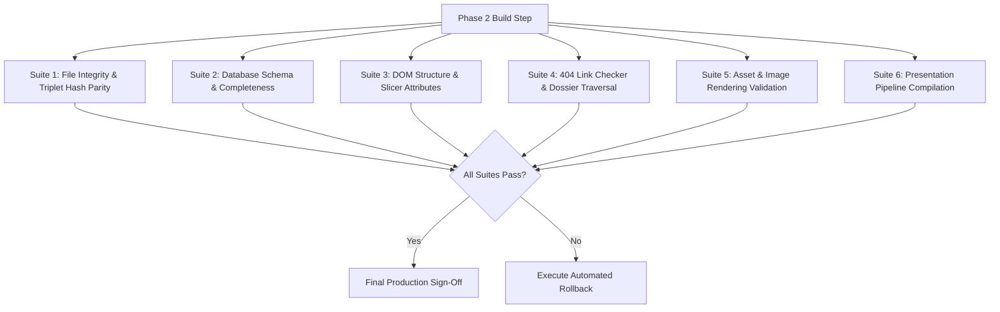

# PHASE 2 REGRESSION TEST & VERIFICATION PLAN
**Project:** Rajasthan Royals SupeRR Selector Season 2  
**Document:** Automated Regression Test Suite & Rollback Specification  
**Location:** `phase1_audit/phase2a_blueprint/REGRESSION_TEST_PLAN.md`  
**Compliance Standard:** Strictly Read-Only Audit & Verification  
**Phase:** Phase 2A — Implementation Blueprint  

---

## 1. OBJECTIVE & GOVERNANCE

The objective of this regression test plan is to guarantee that the integration of Phase 1 Step 4 harmonized rankings into the Rajasthan Royals analytics website produces **zero functional, visual, structural, or cryptographic regressions**.

### Test Suite Execution Gate
No production modification in Phase 2 may be deemed complete until all test suites described herein execute with **$100\%$ PASS** status via an automated verification script (`phase1_audit/phase2_verification/run_regression_tests.py`).

---

## 2. REGRESSION TEST MATRIX



### Suite 1: File Integrity & Triplet Hash Parity
- **Test 1.1 (Original Dataset Preservation):**
  - Verify that the SHA-256 hashes of the six official CSV datasets match their baseline hashes in `PRODUCTION_BASELINE_HASHES.txt` with zero byte alteration.
- **Test 1.2 (Dashboard Triplet Parity):**
  - Verify that `index.html`, `rr_pressure_dashboard.html`, and `rr_war_room_terminal.html` have identical file sizes and identical SHA-256 hashes:
    $$\text{SHA256}(\text{index.html}) == \text{SHA256}(\text{rr\_pressure\_dashboard.html}) == \text{SHA256}(\text{rr\_war\_room\_terminal.html})$$

### Suite 2: Database Schema & Ranking Completeness
- **Test 2.1 (Schema Completeness):**
  - Every player record in `players_db.json` must contain all 36 specified keys.
  - No required field may be `undefined` or omitted.
- **Test 2.2 (Score Parity with Step 4 CSVs):**
  - Verify that every player in `players_db.json` matches the exact `shrunk_score`, `rank`, `career_balls`, `pressure_balls`, and confidence interval values recorded in `FINAL_BATTER_RANKINGS.csv`, `FINAL_BOWLER_RANKINGS_RAE.csv`, or `FINAL_BOWLER_RANKINGS_COMPOSITE.csv`.
- **Test 2.3 (Volume Badge Assignment):**
  - Verify that any player with $40 \le N < 75$ has `sample_size_badge == "Small Sample Caution (40 <= N < 75)"`.

### Suite 3: DOM Structure & Interactive Slicer Attributes
- **Test 3.1 (Table & Section Element Existence):**
  - Assert that `#section-batters`, `#section-bowlers`, `#section-superstars`, and `#section-tactical-xi` exist in the DOM.
  - Assert that `#table-batters`, `#table-bowlers`, and `#table-superstars` exist with their respective `<tbody>` containers.
- **Test 3.2 (Row Count Integrity):**
  - `#table-batters` tbody must contain exactly 10 player rows.
  - `#table-bowlers` tbody must contain exactly 10 player rows.
  - `#table-superstars` tbody must contain exactly 5 player rows.
- **Test 3.3 (Data Attribute Contract):**
  - Every `<tr>` in `#table-batters` and `#table-bowlers` must possess valid, non-empty attributes:
    `data-role`, `data-diff`, `data-win`, `data-index`, `data-rank`.
  - Assert that `parseFloat(row.getAttribute('data-index'))` returns a valid finite number.
- **Test 3.4 (Inline JavaScript Integrity):**
  - Assert that `applySlicers()`, `resetSlicers()`, and `showSection()` exist in the inline script block and contain no unescaped syntax errors.

### Suite 4: 404 Link Checker & Dossier Traversal
- **Test 4.1 (Dashboard Outbound Links):**
  - Extract all `href` attributes matching `players/*.html` from `index.html`.
  - Verify that every target file exists physically on disk in `C:\RR NEW\players\`.
  - Assert **zero broken links (404 errors)**.
- **Test 4.2 (Dossier Inbound / Return Links):**
  - For every HTML file in `players/`, extract all `href` attributes.
  - Verify that `../index.html` (or `../rr_pressure_dashboard.html`) points to an existing file.
  - Verify that carousel links to adjacent player dossiers (e.g. `prev_player.html`, `next_player.html`) exist on disk.

### Suite 5: Asset & Image Rendering Validation
- **Test 5.1 (Image Tag Integrity):**
  - Every `` tag in `index.html` and `players/*.html` must feature a valid `src` attribute.
  - Assert that `src` is either:
    1. A valid Base64 PNG data URI (`data:image/png;base64,...`) with minimum payload $> 1,000$ bytes.
    2. A valid Base64 / UTF-8 SVG data URI (`data:image/svg+xml;...`) with valid XML tags `<svg>` and `</svg>`.
  - Assert that no `src` attribute is empty, broken, or pointing to a non-existent external URL.

### Suite 6: Presentation Pipeline Compilation
- **Test 6.1 (`build_clean_submission_pptx.py` Execution):**
  - Run `python build_clean_submission_pptx.py`.
  - Assert exit code $0$.
  - Assert output file `RR_SupeRR_Selector_Season2_Ketan_Rawat.pptx` is generated with size $> 200,000$ bytes.
- **Test 6.2 (`build_submission_pdf.py` Execution):**
  - Run `python build_submission_pdf.py`.
  - Assert exit code $0$.
  - Assert output file `RR_SupeRR_Selector_Season2_Report_Ketan_Rawat.pdf` is generated with size $> 200,000$ bytes.

---

## 3. AUTOMATED REGRESSION SCRIPT SPECIFICATION

In Phase 2, a dedicated automated test script will be executed:
`phase1_audit/phase2_verification/test_website_regression.py`

```python
"""
Automated Phase 2 Regression Test Suite (test_website_regression.py)
Executes all 6 suites and reports detailed pass/fail assertions.
"""
def test_all():
    suite1_file_integrity()
    suite2_schema_and_scores()
    suite3_dom_and_slicers()
    suite4_link_checker()
    suite5_asset_rendering()
    suite6_presentation_compilation()
    print("ALL REGRESSION SUITES PASSED (100% GREEN)")
```

---

## 4. ROLLBACK & RECOVERY SPECIFICATION

In the event of an unresolvable test failure during Phase 2 implementation, the following rollback procedure must be executed immediately:

1. **Pre-Implementation Backup:**
   - Before modifying any file in Phase 2, a complete timestamped backup snapshot of all production files will be created in:
     `phase1_audit/phase2_backup_pre_implementation/`
2. **Instant Rollback Execution:**
   - If any test in Suites 1–6 fails and cannot be resolved, an automated rollback script (`phase1_audit/phase2_backup_pre_implementation/restore_baseline.py`) will restore:
     - `index.html`
     - `rr_pressure_dashboard.html`
     - `rr_war_room_terminal.html`
     - `players_db.json`
     - `players/` directory
   - Checksums will be verified against `phase1_audit/phase2a_blueprint/PRODUCTION_BASELINE_HASHES.txt` to confirm 100% restoration to the pre-implementation state.
3. **Zero Data Loss Guarantee:**
   - Because the original six CSV datasets and Phase 1 audit folders are strictly read-only, core data can never be compromised.

